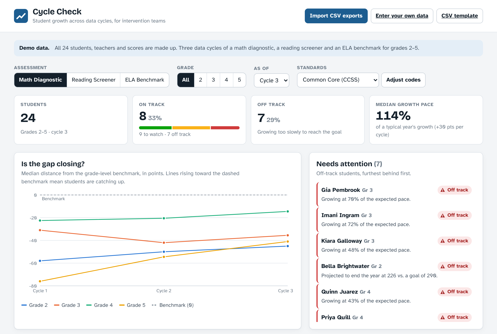
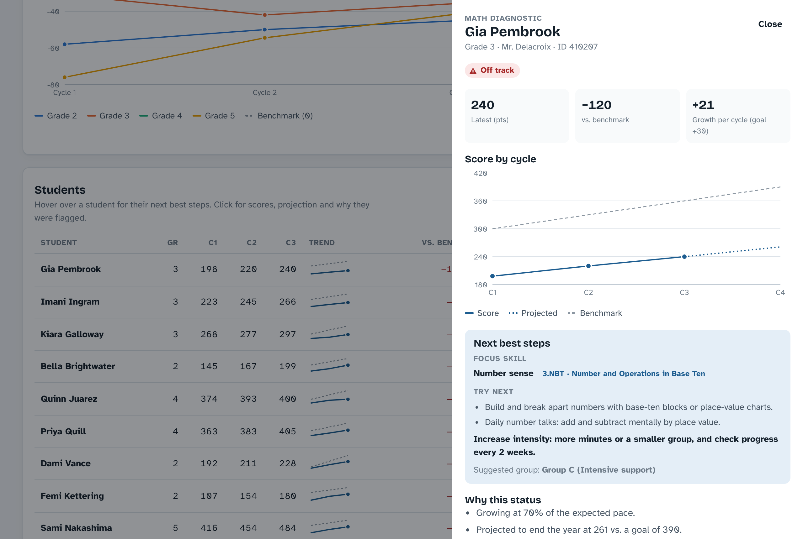
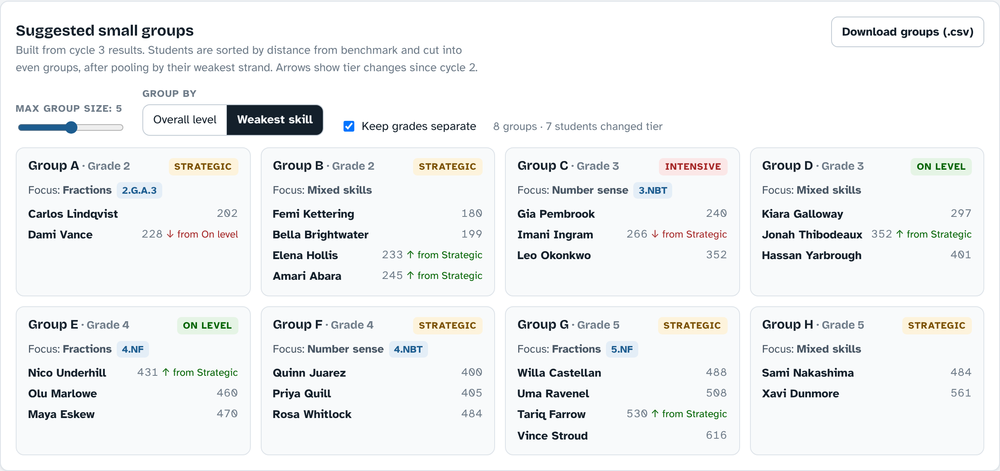
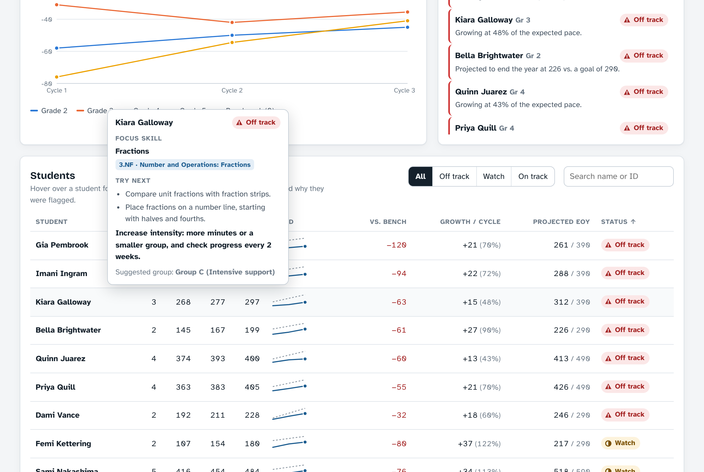
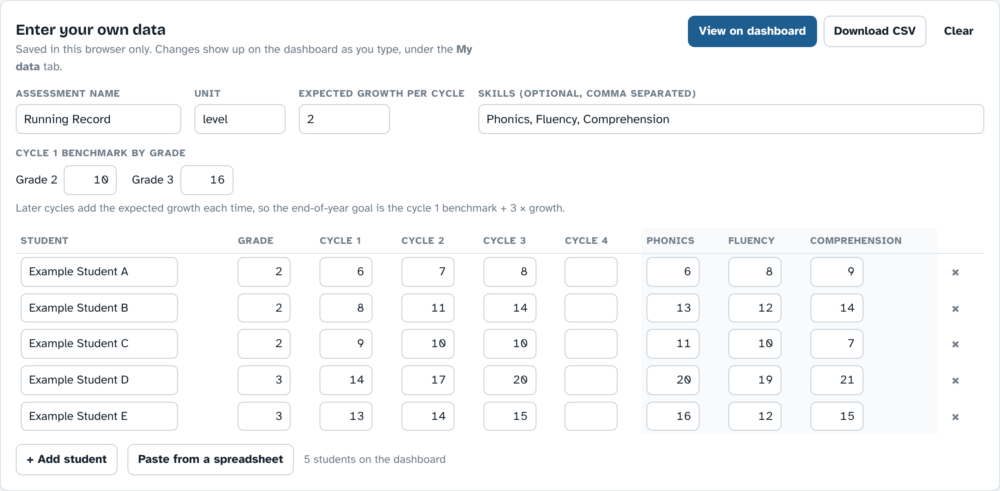
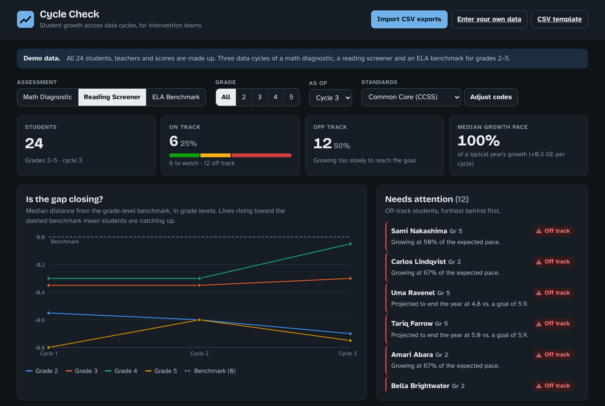

# Cycle Check: Student Growth Dashboard

A React dashboard that turns raw assessment exports into the answers an intervention team needs at a data meeting:

- **Is each student growing fast enough to reach grade level by the end of the year?**
- **Who is off track, and why?**
- **How should small groups change this cycle?**

Drop in CSV exports from a math diagnostic, a reading screener or an ELA benchmark, use the simple template for any other assessment, or type scores straight into the app. It cleans the data, charts growth across data cycles, flags off-track students with a plain-English reason, and suggests new intervention groups you can download. Skills are tagged with standard codes (Common Core by default, or Georgia, Texas or Virginia codes filled in automatically), and hovering over a student shows their next best steps.

**[Live demo](https://havvie.github.io/student-growth-dashboard/)** · All data in the demo is made up.



## Why I built this

I've spent 9+ years teaching, most recently as an Early Intervention Program (EIP) teacher for grades 2–5. Every data cycle I pulled exports from three or four platforms, pasted them into spreadsheets, and hand-built the same views: who moved, who stalled, and who should be regrouped. Each platform reports growth in different units, so nothing lined up.

Cycle Check is the tool I wanted at those meetings. It puts different assessments on a common footing (distance from the grade-level benchmark, and growth compared with a typical year's pace) so the team can spend the meeting on instruction instead of spreadsheets.

## Features

| | |
|---|---|
| **CSV import with a data-quality report** | Detects the export format from its headers, assigns each row to a data cycle from the test date, trims messy names, removes duplicate rows, and keeps blank scores as *missing* (an absent student is not a zero). Every file gets a report of what was cleaned. |
| **Gap trend chart** | Median distance from benchmark per grade, cycle over cycle. Lines rising toward the benchmark mean the gap is closing. |
| **On track / Watch / Off track** | Growth per cycle is a least-squares slope across all cycles, projected to the end of the year and compared with the end-of-year goal. *Watch* means a student is behind but growing at least at the expected pace. |
| **"Why this status"** | Each flag explains itself: "Growing at 48% of the expected pace", "Dropped 12 points from cycle 2 to 3", "Projected to end the year at 2.0 vs. a goal of 2.9". |
| **Student drawer** | Score by cycle with the benchmark and a dashed projection, plus skill scores with the weakest skill highlighted. |
| **Regrouping suggestions** | Groups by overall level or by shared weakest skill (math strands, reading skills or ELA domains), with a group-size limit and an option to keep grades separate. Shows which students moved up or down a tier since last cycle. Download as CSV. |
| **Enter your own data** | No export? Name the assessment, set a cycle 1 benchmark per grade and the expected growth per cycle, then type scores in or paste rows from Google Sheets or Excel. Add optional skill columns to unlock weakest-skill groups. Entries are saved in the browser, show up under a *My data* tab with every chart and flag, and download as a CSV you can import later. |
| **Standards** | Every skill is tagged with a standard code for the student's grade, such as `3.NF` or `RF.2.3`. Pick a state and its codes fill in automatically. Built in: Common Core (default), Georgia, Texas and Virginia. For anything not built in, *Fill missing* lets you type a code once, using `{g}` for the grade (for example `{g}.NR.4`), and it's saved in the browser. Codes show on groups, in the student panel and in the groups CSV. |
| **Next best steps** | Hover over (or tab to) a student to see their focus skill and its standard, two classroom-ready moves for that skill, a recommendation based on their growth pace, and their suggested group. The same card appears in the student drawer for touch screens. |
| **Private by design** | Everything runs in the browser. Imported files are never uploaded anywhere. |
| **Accessible** | Status is shown with an icon and a word, never color alone. Keyboard-navigable table, light and dark themes, and a highly legible typeface (Atkinson Hyperlegible). |

| Student detail | Suggested groups |
|---|---|
|  |  |

| Next best steps on hover | Enter your own data |
|---|---|
|  |  |

| Data import report | Dark mode |
|---|---|
|  |  |

## How growth is measured

Each assessment defines a benchmark for every grade and cycle, and how much growth a typical year adds per cycle (the school year has 4 data cycles):

| Assessment | Unit | Benchmark | Expected growth per cycle |
|---|---|---|---|
| Math Diagnostic | scale score | grade × 100 at cycle 1 (e.g. 300 = ready for 3rd grade) | +30 |
| Reading Screener | grade-level equivalent | the student's grade at cycle 1 (e.g. 3.0) | +0.3 |
| ELA Benchmark | percent correct | 70% every cycle (new standards each test) | hold at 70%+ |
| Custom CSV | your units | from the `benchmark` column | from the `expected_growth` column |

For each student:

1. **Growth** = least-squares slope of score vs. cycle.
2. **Projected end of year** = latest score + growth × cycles remaining.
3. **On track** if the projection reaches the end-of-year goal. **Watch** if not, but the student is growing at least at the expected pace (or is at benchmark now). **Off track** otherwise.
4. **Tier** for grouping = distance from benchmark measured in cycles of typical growth: more than 3 cycles (about a year) behind is *Intensive*, more than 1 is *Strategic*, otherwise *On level*.

The rules live in [`src/lib/metrics.js`](src/lib/metrics.js) and [`src/lib/grouping.js`](src/lib/grouping.js) and are covered by unit tests.

## Use your own data

There are three ways in:

1. **Type it in.** Use *Enter your own data* at the bottom of the page. It's best for a running record, a school-made benchmark or any score you track by hand.
2. **Paste it.** In the same section, choose *Paste from a spreadsheet* and paste rows in the order Name, Grade, Cycle 1–4, then any skill columns.
3. **Import a CSV.** Click **CSV template** for the generic format. Any column named `skill_<name>` becomes a skill score.

```csv
student_id,student_name,grade,teacher,assessment,cycle,date,score,benchmark,expected_growth,unit,skill_Phonics
900001,Sample Student A,3,Room 12,Running Record,1,2025-09-02,14,16,2,level,12
```

The three built-in formats in [`public/sample-data`](public/sample-data) use generic column names, and each one also accepts a few common alternative headers. Real exports vary by platform and district, so add aliases or a new format in [`src/lib/sources.js`](src/lib/sources.js) if yours differ.

## Standards

[`src/lib/standards.js`](src/lib/standards.js) maps each skill to a standard code for grades 2–5. Codes are stored grade by grade, and a cell is left empty when it couldn't be confirmed from the state's text, so nothing is guessed.

| Set | Math | Reading / ELA |
|---|---|---|
| Common Core (default) | domain level, e.g. `3.NF`; grade 2 fractions use `2.G.A.3` | `RF.{g}.3`, `RF.{g}.4`, `L.{g}.4`, `RL.{g}.1–3`, `RL.{g}.4–6`, `L.{g}.1–2` |
| Georgia | grades 2–5 (`3.NR.4`, `4.GSR.7–8`, …) | grades 3–5 (`3.F.P.4`, `4.L.V.3`, …); grade 2 not yet |
| Texas (TEKS) | grades 2–5 (`3.3`, `4.6–4.7`, …) | grades 2–5 (`3.2(A)`, `5.11(D)`, …) |
| Virginia (SOL) | not yet | grades 2–5 (`3.FFR.3`, `4.RV.1`, `5.LU.1–2`, …) |

### Standards sources

- Common Core: [corestandards.org](https://www.corestandards.org/)
- Georgia math: [Georgia's K-12 Mathematics Standards](https://gadoe.org/External-Affairs-and-Policy/communications/Documents/math_standards/Georgia's%20K-8%20Mathematics%20Standards.pdf) (GaDOE), with grades 4–5 checked against Cobb County's copies ([grade 4](https://media.cobbk12.org/media/WWWCobb/medialib/4th-grade-math-website.2d186d86320.pdf), [grade 5](https://media.cobbk12.org/media/WWWCobb/medialib/5th-grade-math-website.fdf03d86321.pdf))
- Georgia ELA: Georgia's K-12 ELA Standards, grades 3–5 (approved May 2023), via [Cobb County's copy](https://media.cobbk12.org/media/WWWCobb/medialib/3-5-ela-standards-2025-2026.1b3c56114217.pdf)
- Texas: 19 TAC [§111.4](https://www.law.cornell.edu/regulations/texas/19-Tex-Admin-Code-SS-111-4)–[§111.7](https://www.law.cornell.edu/regulations/texas/19-Tex-Admin-Code-SS-111-7) (math) and [§110.4](https://www.law.cornell.edu/regulations/texas/19-Tex-Admin-Code-SS-110-4)–[§110.7](https://www.law.cornell.edu/regulations/texas/19-Tex-Admin-Code-SS-110-7) (ELAR)
- Virginia: [2024 English Standards of Learning](https://files-backend.assets.thrillshare.com/documents/asset/uploaded_file/103/Lcps/aa3ea0fc-f5f7-4ffa-a9d2-0d34261497ef/2024_English_Standards_of_Learning_K-12.pdf?disposition=inline) (VDOE, March 2024, Loudoun County copy)

Some skills here cover more than one standard, so codes point to the closest domain, cluster or strand rather than a single benchmark. To add a state, add an entry to `STANDARD_SETS` with codes by grade. Florida (B.E.S.T.), Indiana and Virginia math are the next ones worth adding.

The next-step suggestions live in [`src/lib/nextSteps.js`](src/lib/nextSteps.js).

## Tech stack

- **React 18** + **Vite** single-page app, no backend
- **Recharts** for the trend and student charts, hand-built SVG sparklines
- **PapaParse** for CSV parsing
- **Vitest** unit tests for parsing, growth math and grouping
- **GitHub Actions** runs the tests and deploys to GitHub Pages on every push to `main`

```
src/
  lib/
    sources.js      assessment formats, benchmarks, cycle windows
    parsers.js      CSV detection, cleaning, data-quality report
    manual.js       typed/pasted data, saved in the browser, exported as CSV
    standards.js    skill → standard code (Common Core or custom)
    nextSteps.js    focus skill and suggested moves for each student
    metrics.js      growth slope, projection, status and flags
    grouping.js     regrouping suggestions and CSV export
  components/       charts, roster table, student drawer, groups, import panel
scripts/generate-sample-data.mjs   seeded fake-data generator
```

## Run it locally

```bash
npm install
npm run dev          # http://localhost:5173
npm test             # unit tests
npm run build        # production build in dist/
npm run sample-data  # regenerate the fake CSVs
```

## Deploy

**GitHub Pages:** push to `main`, then in the repo go to *Settings → Pages* and set *Source* to **GitHub Actions**. The included workflow tests, builds and publishes the site to `https://<your-username>.github.io/student-growth-dashboard/`.

**Vercel:** import the repo; the defaults (framework *Vite*, output `dist`) work as is.

## Ideas for next steps

- **Accounts and saved history:** a Node/Express + MongoDB API so a team shares one roster and keeps group history across years, instead of one browser's storage
- **Column mapping on import:** pick which column is the name, grade and score, so any export works without code changes
- **Goal setting per student:** custom end-of-year goals, such as an IEP or EIP exit target, instead of one benchmark per grade
- **Data-meeting summary:** a one-page printable or AI-written summary of each group's needs and next steps
- **Per-standard item analysis** from benchmark exports

## License

MIT
