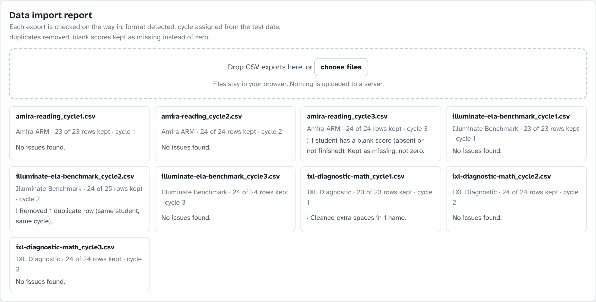

# Cycle Check: Student Growth Dashboard

A React dashboard that turns raw assessment exports into the answers an intervention team needs at a data meeting:

- **Is each student growing fast enough to reach grade level by the end of the year?**
- **Who is off track, and why?**
- **How should small groups change this cycle?**

Drop in IXL, Amira or Illuminate style CSV exports (or any assessment using the simple template), and the app cleans the data, charts growth across data cycles, flags off-track students with a plain-English reason, and suggests new intervention groups you can download.

**[Live demo](https://havvie.github.io/student-growth-dashboard/)** · All data in the demo is made up.


## Why I built this

I've spent 9+ years teaching, most recently as an Early Intervention Program (EIP) teacher for grades 2–5. Every data cycle I pulled exports from three or four platforms, pasted them into spreadsheets, and hand-built the same views: who moved, who stalled, and who should be regrouped. Each platform reports growth in different units, so nothing lined up.

Cycle Check is the tool I wanted at those meetings. It puts different assessments on a common footing (distance from the grade-level benchmark, and growth compared with a typical year's pace) so the team can spend the meeting on instruction instead of spreadsheets.

## Features

| | |
|---|---|
| **CSV import with a data-quality report** | Detects the export format from its headers, assigns each row to a data cycle from the test date, trims messy names, removes duplicate rows, and keeps blank scores as *missing* (an absent student is not a zero). Every file gets a report of what was cleaned. |
| **Gap trend chart** | Median distance from benchmark per grade, cycle over cycle. Lines rising toward the benchmark mean the gap is closing. |
| **On track / Watch / Off track** | Growth per cycle is a least-squares slope across all cycles, projected to the end of the year and compared with the end-of-year goal. *Watch* means a student is behind but growing at least at the expected pace. |
| **"Why this status"** | Each flag explains itself: "Growing at 48% of the expected pace", "Dropped 12 points from cycle 2 to 3", "Projected to end the year at 2.0 vs. a goal of 2.9". |
| **Student drawer** | Score by cycle with the benchmark and a dashed projection, plus strand scores with the weakest strand highlighted (IXL). |
| **Regrouping suggestions** | Groups by overall level or by shared weakest skill, with a group-size limit and an option to keep grades separate. Shows which students moved up or down a tier since last cycle. Download as CSV. |
| **Private by design** | Everything runs in the browser. Imported files are never uploaded anywhere. |
| **Accessible** | Status is shown with an icon and a word, never color alone. Keyboard-navigable table, light and dark themes, and a highly legible typeface (Atkinson Hyperlegible). |

| Student detail | Suggested groups |
|---|---|
|  |  |

| Data import report | Dark mode |
|---|---|
|  |  |

## How growth is measured

Each assessment defines a benchmark for every grade and cycle, and how much growth a typical year adds per cycle (the school year has 4 data cycles):

| Assessment | Unit | Benchmark | Expected growth per cycle |
|---|---|---|---|
| IXL-style Diagnostic (Math) | diagnostic level | grade × 100 at cycle 1 (e.g. 300 = ready for 3rd grade) | +30 |
| Amira-style ARM (Reading) | grade-level equivalent | the student's grade at cycle 1 (e.g. 3.0) | +0.3 |
| Illuminate-style Benchmark (ELA) | percent correct | 70% every cycle (new standards each test) | hold at 70%+ |
| Custom CSV | your units | from the `benchmark` column | from the `expected_growth` column |

For each student:

1. **Growth** = least-squares slope of score vs. cycle.
2. **Projected end of year** = latest score + growth × cycles remaining.
3. **On track** if the projection reaches the end-of-year goal. **Watch** if not, but the student is growing at least at the expected pace (or is at benchmark now). **Off track** otherwise.
4. **Tier** for grouping = distance from benchmark measured in cycles of typical growth: more than 3 cycles (about a year) behind is *Intensive*, more than 1 is *Strategic*, otherwise *On level*.

The rules live in [`src/lib/metrics.js`](src/lib/metrics.js) and [`src/lib/grouping.js`](src/lib/grouping.js) and are covered by unit tests.

## Use your own data

Click **CSV template** in the app for the generic format:

```csv
student_id,student_name,grade,teacher,assessment,cycle,date,score,benchmark,expected_growth
900001,Sample Student A,3,Room 12,Running Record Level,1,2025-09-02,14,16,2
```

The IXL, Amira and Illuminate layouts in [`public/sample-data`](public/sample-data) are simplified approximations of those platforms' exports. Real exports vary by district settings, so map columns in [`src/lib/sources.js`](src/lib/sources.js) if yours differ. This project is not affiliated with IXL Learning, Amira Learning or Illuminate Education.

> **Student privacy:** never commit real student data to a repository. The demo data is generated by [`scripts/generate-sample-data.mjs`](scripts/generate-sample-data.mjs) from a fixed random seed. Every name, ID and score is invented, and a few realistic data problems (a duplicate row, a blank score, extra spaces in a name, a mid-year enrollee) are planted on purpose to exercise the import checks.

## Tech stack

- **React 18** + **Vite** single-page app, no backend
- **Recharts** for the trend and student charts, hand-built SVG sparklines
- **PapaParse** for CSV parsing
- **Vitest** unit tests for parsing, growth math and grouping
- **GitHub Actions** runs the tests and deploys to GitHub Pages on every push to `main`

```
src/
  lib/
    sources.js      assessment formats, benchmarks, cycle windows
    parsers.js      CSV detection, cleaning, data-quality report
    metrics.js      growth slope, projection, status and flags
    grouping.js     regrouping suggestions and CSV export
  components/       charts, roster table, student drawer, groups, import panel
scripts/generate-sample-data.mjs   seeded fake-data generator
```

## Run it locally

```bash
npm install
npm run dev          # http://localhost:5173
npm test             # unit tests
npm run build        # production build in dist/
npm run sample-data  # regenerate the fake CSVs
```

## Deploy

**GitHub Pages:** push to `main`, then in the repo go to *Settings → Pages* and set *Source* to **GitHub Actions**. The included workflow tests, builds and publishes the site to `https://<your-username>.github.io/student-growth-dashboard/`.

**Vercel:** import the repo; the defaults (framework *Vite*, output `dist`) work as is.

## Ideas for next steps

- A Node/Express + MongoDB API to save cycles and group history across the year
- Per-standard item analysis from benchmark exports
- An AI-written summary of each group's needs for the data-meeting agenda

## License

MIT
